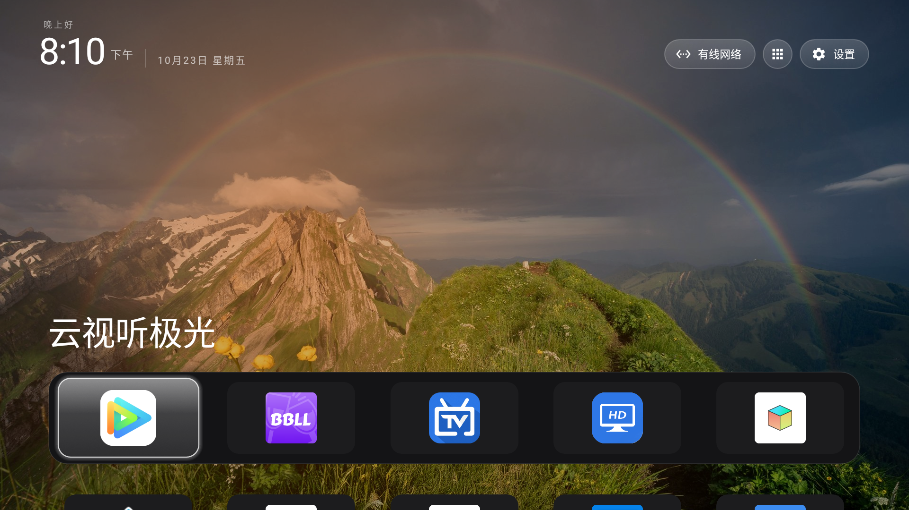
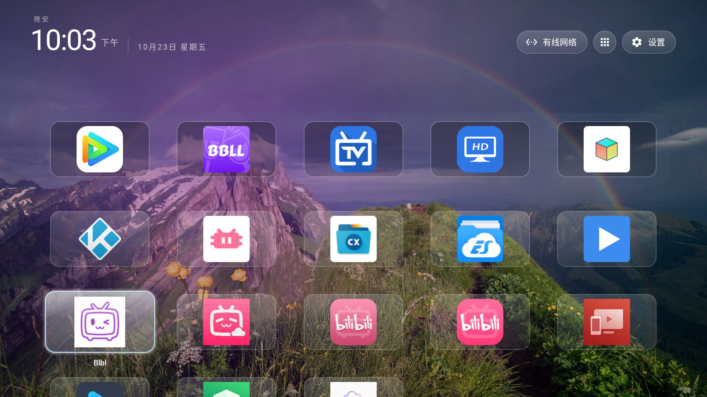
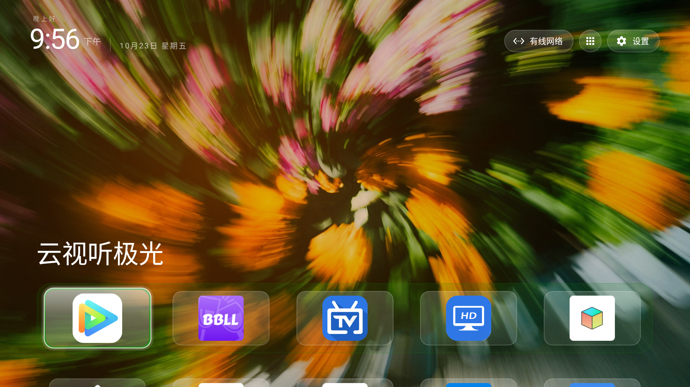

# gathin for TCL / 雷鸟 sugarcane（Android 8.0 / SDK 26 / MStar）

本仓库是 [CleanYourTV（gathin）](https://github.com/Gathin23/cleanyourtv) 启动器在 **TCL 雷鸟 sugarcane** 固件（Android 8.0 / API 26 / MStar 平台）上的**设备专属适配版**，MIT 许可证，原作者版权保留。

> 它不是一个通用 fork，而是「在官方 gathin 源码基础上、叠加 sugarcane 固件需要的几处改动」的集合。大多数代码来自上游，本文只记录 TCL 相关的差异与踩坑。

## 桌面截图

| 主屏与 dock | 应用网格 | 壁纸主色焦点环 |
|---|---|---|
|  |  |  |

壁纸为内置五张照片轮播中的两张（山间彩虹 / 流光花影，出处见[壁纸版权](#壁纸版权)）。右图可见焦点环取了流光花影壁纸的主色。

## 设备与目标

- 设备：TCL 雷鸟 sugarcane（中国版），Android 8.0 / SDK 26 / MStar。
- 目标：用 gathin 取代原生桌面，接管 Home 键与几个被固件绑到购物/推荐类 app 的遥控器按键。
- 调试入口：`adb connect <TV_IP>:5555`（无线 adb，端口 5555）。`<TV_IP>` 是你电视在局域网里的地址。

## 相对上游的改动

1. **遥控器按键改绑**（见 `app/src/main/res/values/config.xml` 的 `app_keys`）：把固件强行绑到自家 app 的遥控器键，改去打开第三方 app。通过 `HomeKeyService` 全局按键过滤实现，任何 app / 原生桌面下均生效（前提：无障碍服务已启用且 `key_filter=true`）。
2. **内置壁纸集与默认轮播**（`ThemeBootstrap.java` + `app/src/main/assets/wallpapers/` + `assets/config.json`）：APK 打包五张 Unsplash 照片（经 guizangTV 核对署名），首次启动复制到主题目录的 `wallpapers/` 下轮播。上游 APK 不含任何内置壁纸。随包默认配置：每 30 分钟轮播、压暗 18%、32 位色解码。
3. **壁纸主色取色**（`WallpaperPlayer.java` + `Config.java` 的 `wallpaper_accent`）：dock 高亮环与焦点环取当前壁纸主色，让桌面跟壁纸风格统一。
4. **dock 长条加深**（`DockDecoration.java` + `AppAdapter.java`）：把底部 dock 横条调成更深的暗色玻璃，和上方图标托盘做出区分。
5. **原生桌面「我的应用」入口**（`AndroidManifest.xml` 给 MainActivity 增加标准 `LAUNCHER` intent-filter）：冷启动停在原生桌面时，可在「我的应用」里找到 gathin 并打开，打开瞬间即接管 Home 与改绑键。

### 壁纸的更换

内置壁纸在 APK 的 `app/src/main/assets/wallpapers/`，首次启动由 `ThemeBootstrap` 复制到电视上的主题目录（仅当缺失，不会覆盖你后来的修改）：

```
/storage/emulated/0/Android/data/com.gathin.tvhome/files/wallpapers/
```

**方式 A · 电视上直接换（不重编译）**：把图片 `adb push` 进上面目录（jpg/png/webp，删掉不想要的），重进 gathin 即生效。同目录的 `config.json` 可调轮播行为：

| 键 | 说明 |
|---|---|
| `wallpaper_rotation_minutes` | 轮播间隔分钟数，0 关闭轮播 |
| `wallpaper_order` | `sequential`（顺序）或 `shuffle`（随机） |
| `wallpaper_dim` | 压暗百分比 0–90（本仓默认 18） |
| `wallpaper_true_color` | 32 位色解码，深色渐变壁纸建议开 |
| `wallpaper_captions` | 显示图片名（需 `wallpapers/captions.txt`） |
| `wallpaper_moods` | 按日出日落分时段轮播（JSON 分组） |
| `wallpaper_accent` | 焦点环 / dock 高亮取壁纸主色（本仓新增键） |

**方式 B · 换 APK 内置集合（重编译）**：替换仓库里 `app/src/main/assets/wallpapers/` 的图片后重新编译安装。注意已安装过的机器上电视端目录优先（首启复制仅缺失时进行），换内置集合后要先删掉电视上的旧 `wallpapers/` 目录或卸载重装。

## 遥控器改绑表

| 原固件键 | Android scanCode | keyCode | 改绑到 |
|---|---|---|---|
| T惠购 | 227 | 4020 | `com.V2.blb5` |
| 同步院线 | 251 | 4503 | `com.fongmi.android.tv`（FongMi 影视） |
| 直播 | 377 | 170 | `com.jerry.livehd`（高清电视） |

`config.xml` 里每条都写了 `scan:<scanCode>:<pkg>` 与 `<keyCode>:<pkg>` 双通道，`scancode` 优先于 `keycode`，两者都写是为了稳妥。要改绑哪个键，按同样的格式加一行、重新编译安装即可。`<TV_IP>` 上抓键值的可靠办法：在 `HomeKeyService.onKeyEvent` 里临时 `Log.d` 打印 `getKeyCode()` / `getScanCode()`，用真遥控器按键后用 `adb logcat` 或 `run-as com.gathin.tvhome cat files/keyprobe.log` 读取（本机 logcat 在此固件上常静默，改用文件落地）。

> 注意：Linux 层 `getevent` 打出的 `EV_KEY` code（如 T惠购 在 Linux 是 226）**不等于** Android 的 `getScanCode()`（这里是 227）。以 Android 层为准。

## 构建与安装

仓库根目录的 `build-and-install.sh`（Linux/macOS）或 `build-and-install.ps1`（Windows）会编译并安装：

```bash
# Linux / macOS
TV_HOST=<TV_IP> ./build-and-install.sh
# Windows (PowerShell)
.\build-and-install.ps1 -TvHost <TV_IP>
```

构建需要本机 Android SDK（JDK 17、Gradle 9.x）。`local.properties` 里的 `sdk.dir` 是机器相关路径，已加入 `.gitignore`，请在自己机器上填。

## 冷启动与服务恢复（重要坑）

- 该 TCL 固件**从不给第三方 app 发 `BOOT_COMPLETED`**，所以开机时 `BootService` 的恢复链不会触发。
- 无障碍服务（HomeKeyService / InputKeyService）的恢复**唯一入口**在 `MainActivity`：打开 gathin 桌面时若发现服务未启用就自动 `repair()`。也就是说，**冷启动后、手动打开 gathin 之前，Home 键与改绑键都不生效**，打开 gathin 瞬间才接管。
- `adb install -r` 会杀掉 gathin 进程，导致 HomeKeyService 解绑（`enabled_accessibility_services` 里还在、但实际没绑定）。装完需要重绑：
  ```bash
  adb -s <TV_IP>:5555 shell "am broadcast -a com.gathin.tvhome.DEBUG_REPAIR"
  ```
- 冷启动时固件还会短暂清空无障碍列表，服务有数秒到约两分钟恢复窗口，期间按键仍会漏给固件。

## 精简系统应用（参考清单，按需禁用）

以下包名在本机上可安全 `pm disable-user` 或 `pm uninstall`（系统应用视固件而定；部分 TCL app 会被固件自动恢复，禁用仅作双保险）。**仅作参考，操作前请确认自己设备的包名**：

批次 1 · 遥测 / 广告 / 诊断：
`com.tcl.bootadservice` `com.tcl.c2dm.client` `com.android.tcl.messagebox` `com.tcl.bi` `com.tcl.usagestats` `com.tcl.tvhealthcheck` `com.tcl.xian.StartandroidService`

批次 2 · 自带内容 / 推荐位 / 商店：
`com.tcl.vod` `com.tcl.tliveplay` `com.tcl.waterfall.resource` `com.tcl.wholenetsearch` `com.tcl.tshop` `com.tcl.ffeducation` `com.tcl.ffkaraoke` `com.tcl.playskill` `com.tcl.browser` `com.tcl.weixin` `com.tencent.qqmusictv` `jd.video.basecomponent`

批次 3 · 语音助手（本机选择不保留）：
`com.iflytek.xiri` `com.iflytek.xiri.recorder.svc` `com.iflytek.xiri2.hal` `com.iflytek.xiri.translate` `com.iflytek.mictest` `com.tcl.micmanager` `com.tcl.walleve` `com.tcl.walleve.aidaemon` `com.tcl.recognize.service`

批次 4 · OTA / 应用商店：
`com.tcl.versionUpdateApp` `com.snm.upgrade` `com.tcl.appmarket2`

## 用 AI Agent 继续定制本仓

本仓本身就是「用户提需求 → AI agent 改代码 → 编译安装验证」迭代的产物，结构对 agent 友好：

- **配置单点化**：日常定制几乎只需要改 `launcher/app/src/main/res/values/config.xml`（键位绑定、dock 应用、网格列数、外观开关），或主题配置 `assets/config.json`、壁纸目录 `assets/wallpapers/`。
- **自带构建安装脚本**：`build-and-install.sh` / `.ps1` 一条命令编译 + adb 安装。
- **踩坑文档自含**：本 README 覆盖了改绑键值探测、服务重绑、冷启动等全部坑，agent 照做即可少走弯路。
- 上游仓库另有面向 agent 的总规则 [AGENTS.md](https://github.com/Gathin23/cleanyourtv/blob/main/AGENTS.md) 与 [PROMPT.md](https://github.com/Gathin23/cleanyourtv/blob/main/PROMPT.md)（电视精简流程的安全守则），涉及禁用系统应用时务必遵循。

其他用户可以基于本仓继续提需求让 AI 完善，比如：把改绑键换成自己的常用 app、调整 dock 应用与网格布局、按自己的审美改焦点环/dock 配色、更换内置壁纸等。可直接把下面这段提示词交给你的 AI agent（Claude Code、Codex 等）：

```text
请基于 GitHub 仓库 kongzong/gathin-tcl-sugarcane（gathin 启动器的 TCL 雷鸟 sugarcane 适配版）帮我定制电视桌面。

背景：
- 我的电视：<型号>，adb 地址：<TV_IP>:5555（先在电视设置里打开 adb 调试）。
- 请先 clone 仓库，通读 README.md（含全部踩坑说明）和
  launcher/app/src/main/res/values/config.xml——这是主要配置点。

我的需求：
1. <例如：把遥控器「XX」键改绑到 <应用包名>；先用探测法拿到键值再写 app_keys>
2. <例如：dock 应用换成：<包名列表>；网格改成 <N> 列>
3. <例如：把内置壁纸换成我的图片，轮播间隔 <N> 分钟>

约束：
- 改动尽量只动 config.xml、assets/config.json、assets/wallpapers/；
  需要改 Java 代码时先说明理由并征得我同意。
- 改完用 launcher/build-and-install.sh（Windows 用 .ps1）编译安装；
  install -r 会杀进程导致按键服务解绑，装完必须执行：
  adb -s <TV_IP>:5555 shell "am broadcast -a com.gathin.tvhome.DEBUG_REPAIR"
- 探测遥控器键值：在 HomeKeyService.onKeyEvent 临时 Log.d 打印
  getKeyCode()/getScanCode()，用真遥控器按键后读取（logcat 静默就落文件）；
  Linux getevent 的 EV_KEY code 与 Android scanCode 不同，以 Android 层为准。
- 未经我确认不要禁用/卸载任何系统应用；确需精简时先看 README 的参考清单并逐包确认。
```

## 许可证

本仓库基于 gathin，遵循其 **MIT 许可证**（见 `LICENSE`）。其中 `app/src/main/res/font/outfit.ttf` 字体为 SIL OFL 1.1，见 `FONT-LICENSE-OFL.txt`。

上游：https://github.com/Gathin23/cleanyourtv

## 壁纸版权

APK 内置的五张壁纸来自 [guizangTV（op7418/guizang-tv）](https://github.com/op7418/guizang-tv) 核对过的同一批 Unsplash 照片（本仓文件与其逐字节一致），适用 [Unsplash License](https://unsplash.com/license)——**不属于本仓代码的 MIT 许可**。可自由复制、修改、分发用于本桌面；不得将未作显著修改的照片单独出售，或汇编成与 Unsplash 相似或竞争的服务。署名副本随源码保存在 `app/src/main/assets/wallpapers/UNSPLASH-NOTICE.txt`。

| 桌面名称 | 摄影师 | 原始页面 |
|---|---|---|
| 雾中雪岭 | Arina Avdzhian | [rSYsP5TlEAk](https://unsplash.com/photos/a-black-and-white-photo-of-a-snow-covered-mountain-rSYsP5TlEAk) |
| 雨林山路 | Geio Tischler | [hqzyUL3M21k](https://unsplash.com/photos/a-winding-road-in-the-middle-of-a-forest-hqzyUL3M21k) |
| 热带绿叶 | Łukasz Rawa | [4axNezh03UA](https://unsplash.com/photos/green-leaves-and-foliage-create-a-dark-and-lush-scene-4axNezh03UA) |
| 山间彩虹 | Pascal Debrunner | [vwFvhJf6u_I](https://unsplash.com/photos/a-rainbow-arches-over-a-majestic-mountain-landscape-vwFvhJf6u_I) |
| 流光花影 | Patrick Shaun | [JtF_FvXVQQI](https://unsplash.com/photos/a-blurry-photo-of-a-bunch-of-flowers-JtF_FvXVQQI) |

来源核对由 guizangTV 于 2026-10-20 完成，逐张署名与处理方式见其 [docs/WALLPAPERS.md](https://github.com/op7418/guizang-tv/blob/main/docs/WALLPAPERS.md)。
